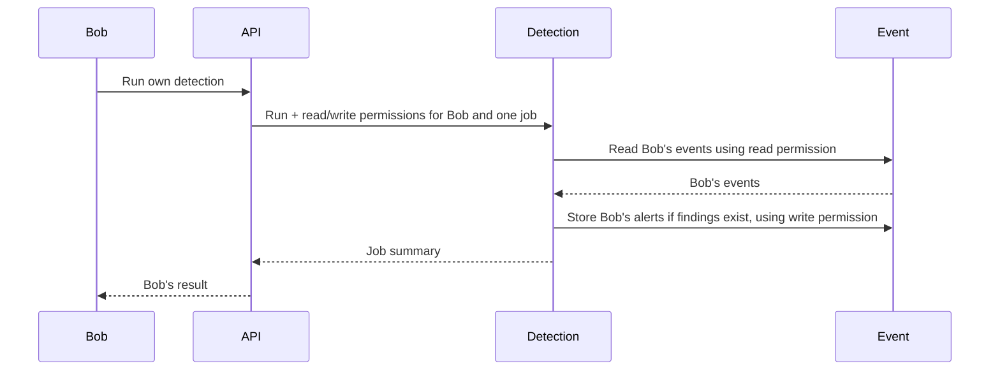

# Cross-service confused deputy in Mini-SIEM

A confused deputy is a component that is allowed to perform an operation but
is tricked into using its authority for someone else's purpose. In Mini-SIEM,
Detection is the deputy: it reads events and writes alerts on behalf of the
user who requested analysis. Event must enforce **whose data** Detection may
access, not grant blanket access because another service is calling.

The V4 scenario is Bob asking for analysis of Alice's events and receiving
Alice-derived results, while his direct ordinary event listing remains limited
to Bob. This differs from V1's missing admin-role check: Bob is legitimately
authenticated and may run detection, but may only analyze his own events.

## Where the protection is used

| Location | Protection against the confused deputy |
| --- | --- |
| [API detection handler](../../cmd/api/detections.go) | Rejects caller-selected owners and issues run/read/write permissions using the authenticated user's ID and one generated job ID. |
| [Job signing and verification](../../internal/auth/job.go) | Binds each permission to an owner, job, receiving service, exact action and 30-second expiry. API alone holds the private signing key. |
| [Job middleware](../../internal/auth/middleware.go) | Verifies authority for this service/action, checks the job header matches the signed job, and establishes the verified owner in request context. |
| [Detection handler](../../cmd/detection/handlers.go) | Requires all three permissions to have the same owner/job; forwards the read/write capabilities unchanged. Checks returned events belong to that owner before analysis. |
| [Event job-read route](../../cmd/event/handlers.go) | Verifies event-read authority and calls `ListByOwner` using the verified principal. Network access or the ability to invoke Detection grants no wider read. |
| [Event alert-write route](../../cmd/event/alerts.go) | Verifies alert-write authority and stores alerts under the signed job owner, not an owner selected in the payload. |
| [Detection rule](../../eventkit/rule.go) | Processes supplied events without user authorization logic. Detection must establish owner isolation before passing events into it. |

Comments at these points explain how the initiating user's authority is
preserved. The normal flow is:



## Important code: with and without scope protection

The unsafe alternatives below are illustrative. They have not been applied or
executed. Names such as `targetOwner` describe a hypothetical attacker-selected
target; the current request model does not expose that field.

### 1. API derives permissions from the authenticated caller

The current handler signs three narrowly scoped permissions:

```go
jobID := rand.Text()
run, runErr := auth.SignJob(jobKey, identity.ID, jobID, auth.DetectionService, auth.RunDetection)
read, readErr := auth.SignJob(jobKey, identity.ID, jobID, auth.EventService, auth.ListEvents)
write, writeErr := auth.SignJob(jobKey, identity.ID, jobID, auth.EventService, auth.AddAlerts)
```

For Bob, every permission names Bob. The public endpoint accepts no owner
parameter: query selectors or a body such as `{"owner_id":1}` return HTTP 400.
Admin's detection jobs also remain limited to Admin's own events.

A dangerous alternative would sign a requested target instead:

```go
// Unsafe illustrative alternative: targetOwner comes from the request.
read, readErr := auth.SignJob(jobKey, targetOwner, jobID, auth.EventService, auth.ListEvents)
```

This would improperly grant authority at API. The current Detection owner/job
matching check would still reject that read permission if the run permission
named Bob. Changing the owner consistently on all permissions would instead
make API itself grant an unauthorized cross-owner job. That is not a bypass
achieved merely by authenticating as Bob.

### 2. Detection keeps its permissions tied to one owner and job

Current code verifies the delegated read and write scopes against the run scope:

```go
scope := auth.JobFromContext(c.Request.Context())
readScope, readErr := auth.VerifyJob(jobKey, input.ReadToken, auth.EventService, auth.ListEvents)
writeScope, writeErr := auth.VerifyJob(jobKey, input.WriteToken, auth.EventService, auth.AddAlerts)
if readErr != nil || writeErr != nil || readScope != scope || writeScope != scope {
    c.JSON(http.StatusUnauthorized, gin.H{"error": "invalid job permissions"})
    return
}
```

Without the owner/job comparison, the weaker condition would be:

```go
if readErr != nil || writeErr != nil {
    c.JSON(http.StatusUnauthorized, gin.H{"error": "invalid job permissions"})
    return
}
```

Each capability could be valid independently yet belong to a different job or
owner. Detection would lose the binding between the initiating request and the
work it performs. This change alone does not forge another user's permission:
Event still verifies the capability and job header, and Detection still checks
the owner of returned events.

### 3. Event uses the signed owner rather than the deputy's requested target

The current job route uses the same owner-filtered handler as ordinary listing:

```go
router.GET("/jobs/events", auth.JobMiddleware(jobKey, auth.EventService, auth.ListEvents), listEvents)
```

Inside that handler, `identity.ID` comes from verified authority:

```go
owned := store.ListByOwner(identity.ID)
```

The unsafe resource-selection alternative would be:

```go
// Unsafe illustrative alternative: targetOwner is selected by the caller.
owned := store.ListByOwner(targetOwner)
```

Even a well-formed positive target ID is not evidence that Bob may access it.
If Event allowed this target to override the signed owner, it would use its
storage access on behalf of an unauthorized request. Checking only that a
service or capability may perform a read would miss whose data it may read.

Detection has another check before passing events to the rule:

```go
if event.OwnerID != scope.OwnerID || event.IngestedAt.IsZero() || ipErr != nil {
    c.JSON(http.StatusBadGateway, gin.H{"error": "invalid Event service response"})
    return
}
```

Consequently, making Event return Alice's events under Bob's job is still
insufficient for successful analysis while this owner check remains active.

### 4. Event also binds alert writes to the delegated owner

Current code uses the verified write scope:

```go
scope := auth.JobFromContext(c.Request.Context())
alerts, err := store.AddAlerts(scope.OwnerID, inputs)
```

Replacing `scope.OwnerID` with an untrusted target would allow a deputy to place
alerts under someone else's account. The current alert request model excludes
an owner field, and Event rejects such extra fields rather than trusting them.

## What the complete confused-deputy failure would mean

For the planned V4 scenario, several protections would have to stop preserving
Bob's scope: API would accept and forward Alice as a requested target, Detection
would use that target without enforcing the initiating owner, and Event would
honor the target instead of its signed owner restriction. Detection's returned-
event owner check would also have to be weakened for Alice's events to be analyzed
under Bob's job. Ordinary public listing could remain owner-scoped throughout.

Bob could then receive counts or alerts derived from Alice's activity without
ever obtaining permission to list her raw events directly. If those findings
were stored under Bob's valid write scope, Bob could retrieve the Alice-derived
alerts through his own ordinary alert listing. Derived data can disclose another
user's activity even when the direct data endpoint remains protected.

Accepting an extra JSON field alone, removing only the job comparison, or
changing an unsigned job header does not establish this complete exploit in the
current implementation. These examples describe failure modes, not observed
vulnerabilities.

## Security consequences of the multi-service architecture

**Preserve the original caller across every hop.** The receiving service must
know which owner and job an operation represents. API checks the user; Detection
checks consistency; Event independently enforces the final read and write scope.
Internal network placement does not supply that authorization.

**Separate permissions limit the deputy's authority.** The run capability targets
Detection. Event's read and write capabilities authorize different actions.
Detection receives a verification public key, not the API signing key, so it
cannot mint an Alice capability or turn a job into admin-list authority.

**A job ID is binding and correlation, not standalone permission.** The job header
must match the signed claim, but knowing or choosing an ID does not authorize a
request. Capabilities are bearer credentials: possession authorizes their exact
scope rather than proving the connecting process is Detection.

**Trust still has limits.** A compromised Detection process could misuse valid
permissions it already holds or fabricate otherwise valid findings for that
owner. Tokens can be replayed until their 30-second expiry; there is no one-use
job enforcement. If API issues inappropriate but internally consistent authority,
Event cannot reconstruct the missing user-policy decision. These limitations do
not give Detection authority to mint broader permissions.

## Existing checks and reproduction

`TestDetectionAPIDelegatesOnlyAuthenticatedOwner` checks identity-derived scope
and rejected selectors. `TestDetectionScopeAndValidation` checks mismatched
owners, jobs, actions and headers before any Event call.
`TestDetectionWorkflowAndUpstreamFailures` checks cross-owner Event responses
are rejected without writing alerts. `TestJobEventAndAlertPermissions` checks
Event's independent read/write enforcement. `TestJobAuthority` and
`TestJobRejectsInvalidClaims` cover signed scope constraints.

Run from the repository root with `MINI_SIEM_TEST_URL` unset so integration starts
isolated local services rather than targeting an existing stack:

```sh
go test -count=1 ./...
```

The existing integration test uses temporary keys, a fresh seeded database and
synthetic events. It checks each user's detection results and rejects owner
selectors without changing the stored data.

Actual verification on 2026-10-23: all seven root-module packages passed.
Relevant output excerpts:

```text
ok  github.com/droggokid/mini-siem                8.538s
ok  github.com/droggokid/mini-siem/cmd/api        6.175s
ok  github.com/droggokid/mini-siem/cmd/detection  0.023s
ok  github.com/droggokid/mini-siem/cmd/event      0.028s
ok  github.com/droggokid/mini-siem/internal/auth  0.022s
```

This update changes explanatory comments and documentation only. All scope
checks remain active; no vulnerable variant was run and no Git operations were
performed.
